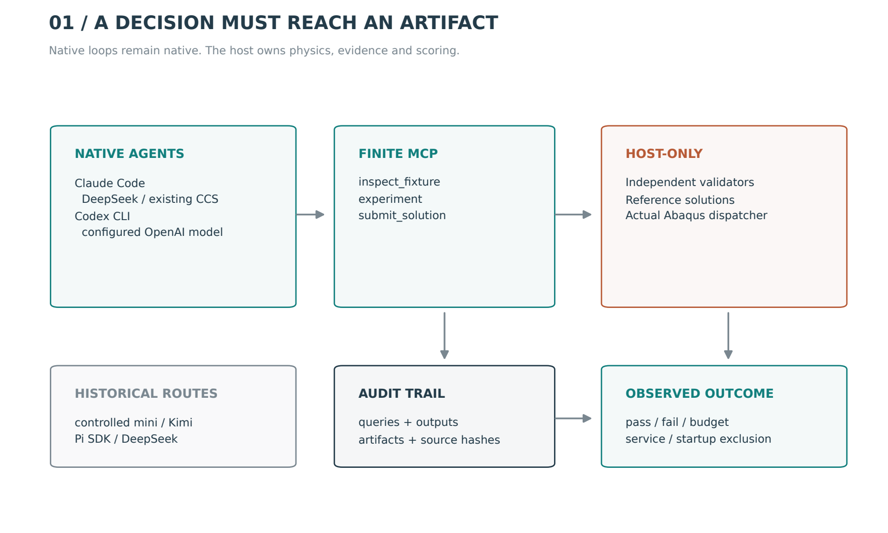
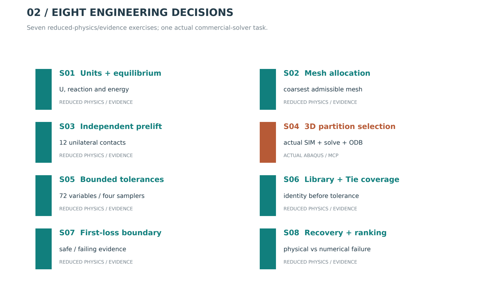
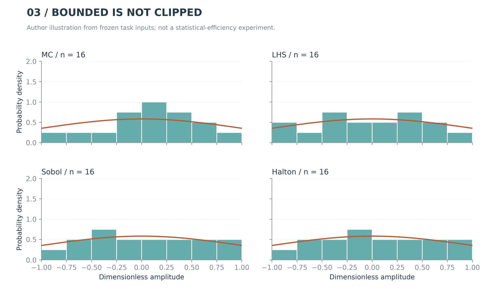
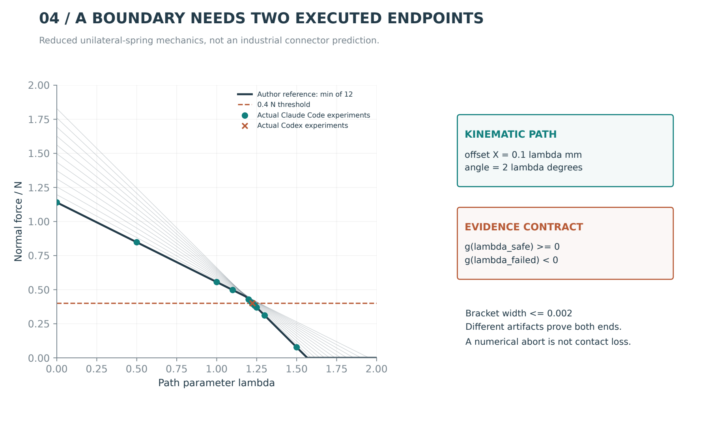
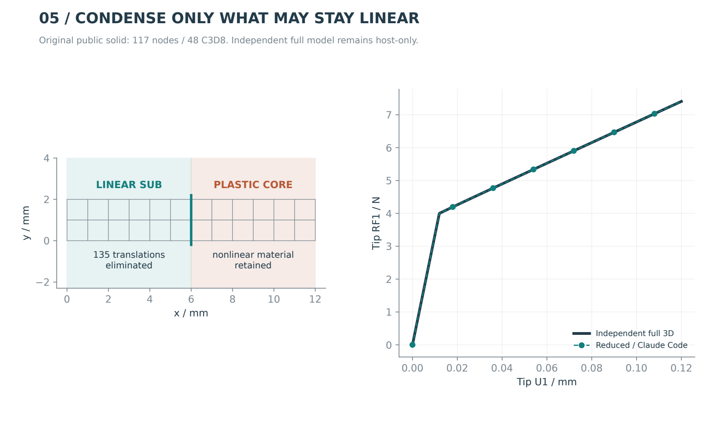
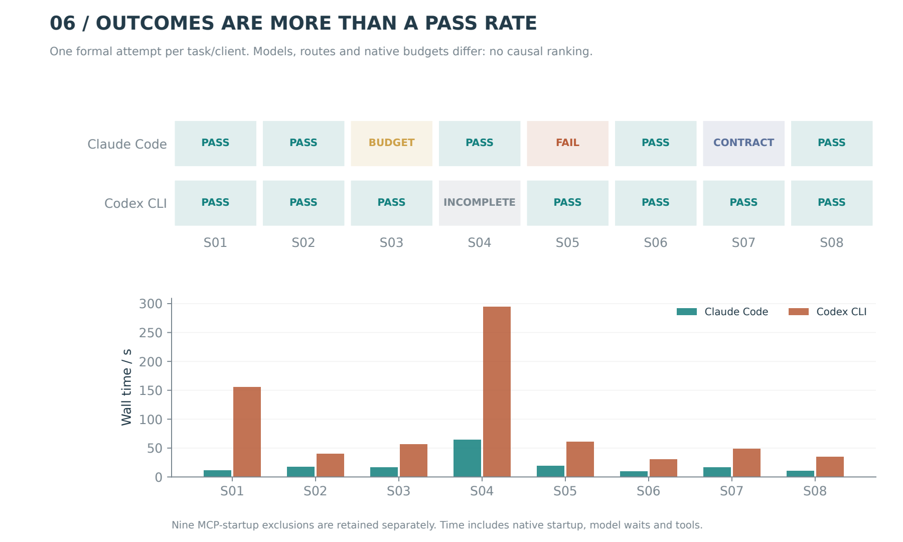

<article class="cae-article">

<a href="/articles/mechagent-lab/mechagent_lab_zh.pdf">中文 PDF</a> · <a href="/articles/mechagent-lab/mechagent_lab_en.pdf">English PDF</a> · <a href="/articles/mechagent-lab/mechagent-lab-source-evidence.zip">Source and evidence</a>

<strong>8 tasks · 2 added native clients · 16 formal attempts · every figure exported by Tavotto</strong>

On this page
<ol><li><a href="#lab-0">Why put mechanics in an agent benchmark?</a></li><li><a href="#lab-1">Agree on evidence before reading scores</a></li><li><a href="#lab-2">Eight tasks that test mechanics rather than wording</a></li><li><a href="#lab-3">An actual substructure decision</a></li><li><a href="#lab-4">Read failures as engineering evidence</a></li><li><a href="#lab-5">Reproduce a decision from its evidence</a></li></ol>

<h2 id="lab-0">Why put mechanics in an agent benchmark?</h2>

Engineering simulation is not primarily a command-generation problem. It requires consistent decisions across physical assumptions, discretization and software state. An agent may explain substructuring yet choose a nonlinear region for condensation, or read a small contact force from an aborted case and call it physical failure. MechAgent Lab therefore evaluates inspectable decisions and artifacts, not engineer-like prose.

Eight public tasks cover units and equilibrium, mesh allocation, independent prelift, substructure partitioning, bounded tolerances, interface reuse, coupled pose boundaries and batch recovery. Original public solids and reduced-physics fixtures replace client geometry, contracts and industrial results.

This extension adds actual Claude Code and Codex Command-Line Interface (CLI) loops. Claude Code uses an existing DeepSeek route; Codex uses an existing ChatGPT login. CCS here refers to the local CC Switch configuration manager, not a model or agent. Earlier controlled-mini/Kimi and Pi/DeepSeek traces remain historical evidence, not matched reruns. A harness name does not identify the underlying model.

<figure><figcaption>Model, native harness, finite tools and host scoring; mini/Pi are historical routes.</figcaption></figure>
<h2 id="lab-1">Agree on evidence before reading scores</h2>

Each agent receives exactly three mechanics capabilities: inspect a fixture, execute an experiment and submit a structured solution. Model Context Protocol (MCP) is the invocation interface, not the solver. Tool arguments expose no arbitrary scripts, paths or terminal commands. Reference solutions and validators stay with the host.

Native means the installed client still owns reasoning, tool selection and context management; no custom inference loop impersonates it. Unrelated Claude tools/plugins and Codex shell/browser capabilities are disabled. This is configuration control plus observable tool auditing, not an operating-system isolation claim.

Task text, execution sources and validators are hashed before formal calls. Each client gets one formal attempt per task. Two Claude starts without tools and seven Codex handshake failures remain as startup exclusions. The valid Codex first task and completed Claude outcomes are not repeated. Transport amendments change the adapter, not physics or scoring.

Every task has at most 24 broker calls and 360 seconds wall time; the partition task permits one native candidate. Claude also has native-turn/request-output limits. Codex does not claim the same hard output-token cap. Different models, native instructions and budgets prevent a causal harness or model ranking.

<table><thead><tr><th>Harness</th><th>Model / Route</th><th>Evidence</th></tr></thead><tbody>
<tr><td>Controlled mini</td><td>Kimi kimi-k2.6</td><td>Historical frozen pilot</td></tr>
<tr><td>Pi SDK</td><td>DeepSeek deepseek-v4-flash</td><td>Historical frozen pilot</td></tr>
<tr><td>Claude Code 2.1.154</td><td>DeepSeek deepseek-v4-flash / CCS</td><td>Eight tasks in this campaign</td></tr>
<tr><td>Codex CLI 0.166.0-alpha.5.1</td><td>gpt-6.1-sol / ChatGPT login</td><td>Eight tasks in this campaign</td></tr></tbody></table>

<h2 id="lab-2">Eight tasks that test mechanics rather than wording</h2>

S01 uses axial bars in series. The agent converts GPa to MPa and checks tip displacement, root reaction and strain energy. Finite Element Method (FEM) results must cite an executed artifact; plausible numbers alone are insufficient.

S02 varies cross-sectional area with position. The objective is the smallest allowed mesh meeting a tip-displacement error bound, not the finest mesh. The independent reference is a continuum compliance integral, whereas elements use midpoint area.

S03 gives six plates six independent controls, each influencing two unilateral contacts. Minimize squared amplitudes while all final normal forces reach 0.4 N. Prelift adds to a nominal displacement; separation produces zero normal force, and friction cannot make up a normal-force deficit. This is a reduced spring model, not a 3D frictional-contact solve.

S04 is the actual commercial-solver task. An original 3D bar has linear-elastic and J2-plastic halves. The agent selects a condensation cut, retains root/interface translations, and executes generation, reduced assembly and Output Database (ODB) extraction through Abaqus/MCP.

S05 samples 72 variables: 42 Z-shape changes, six independent prelifts and 24 local male-terminal X/Y translations. Monte Carlo (MC), Latin Hypercube Sampling (LHS), Sobol and Halton first sample the unit cube, then apply the inverse standard-normal CDF conditioned on [-1,1]. Conditioning is not endpoint clipping.

The physical maps are 0.15a mm for shape change, 0.3348+0.15a mm for prelift, and 0.1a mm for rigid local translation. Local manufacturing offsets preserve terminal dimensions and do not move the substructure. Whole-male assembly pose is a different variable.

S06 checks both library identity and Tie coverage. CORE denotes explicitly represented finite elements; SUB denotes the condensed region. Reuse requires matching topology, material and retained-node coordinates. A search tolerance cannot repair a wrong material or mesh, and disabling adjustment prevents the Tie from pulling a manufacturing offset back to nominal.

S07 finds first contact loss along a prescribed coupled offset/angle path. Each experiment returns twelve normal forces; the minimum is compared with 0.4 N. Two actual artifacts must prove a safe/failing bracket. The lever-arm/unilateral-spring numbers are not industrial connector limits.

S08 tests evidence reliability and recovery. Rank only completed cases at final displacement with all twelve channels, then sort by minimum absolute normal force. A case is one input/output instance. Completed physical failures stay done; active jobs wait, missing channels require re-extraction, interrupted jobs require re-solving, and negative-volume input requires mesh repair.

<figure><figcaption>Eight decisions and evidence tiers; only S04 uses actual Abaqus.</figcaption></figure>
<figure><figcaption>One representative bounded marginal per sampler; sixteen samples do not establish efficiency.</figcaption></figure>
<figure><figcaption>S07 reduced-physics path and actual agent experiments; not an industrial connector prediction.</figcaption></figure>
<h2 id="lab-3">An actual substructure decision</h2>

The public 12 by 2 by 2 mm solid has 117 nodes and 48 C3D8 elements. Condensation cannot extend into potentially plastic material. A Schur complement eliminates internal Degrees of Freedom (DOFs). The maximal safe cut at 6 mm eliminates 135 internal translations.

An independent full solve precedes agent execution and is not visible through its tools. Actual Abaqus/MCP generates a SIM library, assembles/solves the reduced model and compares stored-frame reactions. This tiny model establishes execution and equivalence, not an industrial speedup. The plotted curves come from the successful Claude Code/DeepSeek extraction, not a theoretical substitute.

Codex also chose the 6 mm cut and 135 eliminated DOFs, but its actual tool returned no artifact within 240 seconds; another candidate request was denied by the one-candidate budget. It submitted an empty artifact ID rather than invent solver success. Its independently scheduled solve later finished, but returned neither an agent-observed artifact before the deadline nor an extracted/checked curve for this attempt. The raw zero remains a tool-timeout/incomplete-evidence outcome; late host success does not retroactively pass the agent. No validated Codex curve is invented.

<math display="block" xmlns="http://www.w3.org/1998/Math/MathML"><msub><mi>K</mi><mi>c</mi></msub><mo>=</mo><msub><mi>K</mi><mrow><mi>b</mi><mi>b</mi></mrow></msub><mo>−</mo><msub><mi>K</mi><mrow><mi>b</mi><mi>i</mi></mrow></msub><msubsup><mi>K</mi><mrow><mi>i</mi><mi>i</mi></mrow><mrow><mo>−</mo><mn>1</mn></mrow></msubsup><msub><mi>K</mi><mrow><mi>i</mi><mi>b</mi></mrow></msub></math>
<figure><figcaption>Actual full/reduced reaction curves and the public partition from this native campaign.</figcaption></figure>
<h2 id="lab-4">Read failures as engineering evidence</h2>

Each matrix cell is a frozen task/client combination. Passing requires independent checks and artifact references. Budget exhaustion, missing submission, service error and adapter failure remain distinct. A success-shaped tool message cannot prove a completed solver run.

Elapsed time includes client startup, model waiting and tools; S04 includes commercial-solver work. It is neither pure inference latency nor a solver speedup. SDK dollar estimates are separate from invoices and may be inappropriate for a third-party route; unknown actual billing stays null.

A correct derivation without submission is a workflow failure. A wrong physical mapping is a semantics failure. Rate limits are environmental, and absent MCP tools are an adapter problem. We retain these distinctions instead of retrying until a clean table appears.

Claude S07 found safe/failing endpoints 1.223 and 1.224 but submitted artifact IDs as an object with safe/fail keys. The frozen validator indexes an array, while the task did not explicitly require that type. Its raw zero stays in the evidence, but this cell is labeled protocol ambiguity rather than a mechanics-boundary error. No extra attempt or retroactive full score is awarded.

The sixteen formal attempts comprise twelve passes, one physical-mapping failure, one budget exhaustion, one incomplete tool-evidence outcome and one protocol ambiguity. Nine additional startup exclusions are retained.

<figure><figcaption>Task outcomes and wall time; different models/routes/budgets prevent causal ranking.</figcaption></figure>

View all 25 retained attempts, including startup exclusions

<table><thead><tr><th>Attempt</th><th>Client</th><th>State</th><th>s</th><th>Tools</th></tr></thead><tbody>
<tr><td>claude-code-S01-a1</td><td>claude-code</td><td>adapter_invalid</td><td>17.5</td><td>0</td></tr>
<tr><td>claude-code-S01-a2</td><td>claude-code</td><td>adapter_invalid</td><td>12.7</td><td>0</td></tr>
<tr><td>claude-code-S01-a3</td><td>claude-code</td><td>passed</td><td>11.5</td><td>4</td></tr>
<tr><td>claude-code-S02-a1</td><td>claude-code</td><td>passed</td><td>18.0</td><td>5</td></tr>
<tr><td>claude-code-S03-a1</td><td>claude-code</td><td>budget_exhausted</td><td>17.2</td><td>7</td></tr>
<tr><td>claude-code-S04-a1</td><td>claude-code</td><td>passed</td><td>64.4</td><td>3</td></tr>
<tr><td>claude-code-S05-a1</td><td>claude-code</td><td>failed</td><td>19.7</td><td>6</td></tr>
<tr><td>claude-code-S06-a1</td><td>claude-code</td><td>passed</td><td>9.6</td><td>3</td></tr>
<tr><td>claude-code-S07-a1</td><td>claude-code</td><td>protocol_ambiguity</td><td>16.9</td><td>18</td></tr>
<tr><td>claude-code-S08-a1</td><td>claude-code</td><td>passed</td><td>10.4</td><td>4</td></tr>
<tr><td>codex-native-S01-a1</td><td>codex-native</td><td>passed</td><td>155.7</td><td>3</td></tr>
<tr><td>codex-native-S02-a1</td><td>codex-native</td><td>adapter_invalid</td><td>6.6</td><td>0</td></tr>
<tr><td>codex-native-S02-a2</td><td>codex-native</td><td>passed</td><td>39.8</td><td>3</td></tr>
<tr><td>codex-native-S03-a1</td><td>codex-native</td><td>adapter_invalid</td><td>2.0</td><td>0</td></tr>
<tr><td>codex-native-S03-a2</td><td>codex-native</td><td>passed</td><td>56.7</td><td>4</td></tr>
<tr><td>codex-native-S04-a1</td><td>codex-native</td><td>adapter_invalid</td><td>2.0</td><td>0</td></tr>
<tr><td>codex-native-S04-a2</td><td>codex-native</td><td>environment_or_incomplete</td><td>294.4</td><td>5</td></tr>
<tr><td>codex-native-S05-a1</td><td>codex-native</td><td>adapter_invalid</td><td>2.0</td><td>0</td></tr>
<tr><td>codex-native-S05-a2</td><td>codex-native</td><td>passed</td><td>60.7</td><td>6</td></tr>
<tr><td>codex-native-S06-a1</td><td>codex-native</td><td>adapter_invalid</td><td>2.0</td><td>0</td></tr>
<tr><td>codex-native-S06-a2</td><td>codex-native</td><td>passed</td><td>30.6</td><td>3</td></tr>
<tr><td>codex-native-S07-a1</td><td>codex-native</td><td>adapter_invalid</td><td>2.0</td><td>0</td></tr>
<tr><td>codex-native-S07-a2</td><td>codex-native</td><td>passed</td><td>48.5</td><td>4</td></tr>
<tr><td>codex-native-S08-a1</td><td>codex-native</td><td>adapter_invalid</td><td>3.0</td><td>0</td></tr>
<tr><td>codex-native-S08-a2</td><td>codex-native</td><td>passed</td><td>34.8</td><td>3</td></tr>
</tbody></table>

<h2 id="lab-5">Reproduce a decision from its evidence</h2>

The archive contains task cards, frozen sources, linked registrations, all retained attempts, complete observable-query appendices, independent scores, original public INP decks, actual MCP job identities, figure data and Tavotto receipts. Every figure is executed/registered/exported in actual Tavotto as PDF and PNG. Both reading editions are compiled from LaTeX.

Start with offline tests and local-mock tool checks. Then configure your own API/native login, MCP installation and commercial-software license. Never put keys in tasks or upload the CCS database. After registration, do not silently alter prompts, tools or validators; amend with preserved history.

Future work should add public problems genuinely requiring 3D contact, mesh quality and path dependence, followed by repeated crossed configurations and explicit spending controls. Until then, evidence provenance is more useful than a polished leaderboard.

<h2>Further reading and inspectable files</h2>

<a href="https://learn.chatgpt.com/docs/non-interactive-mode">Codex non-interactive execution</a> · <a href="https://code.claude.com/docs/en/headless">Claude Code programmatic execution</a> · <a href="/post/2026/11/04/mechanics-benchmark-v02/">Historical mini / Pi records</a>

<a href="/articles/mechagent-lab/summary.csv">CSV</a> · <a href="/articles/mechagent-lab/summary.json">JSON</a> · <a href="/articles/mechagent-lab/native_extension_registration.json">Frozen registration</a>

</article>