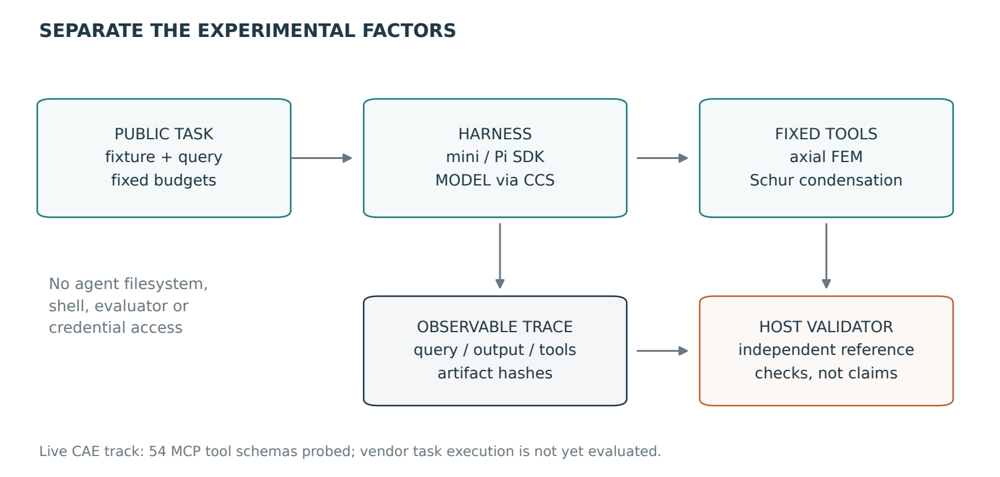
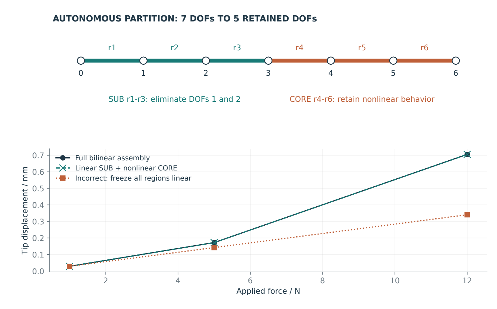
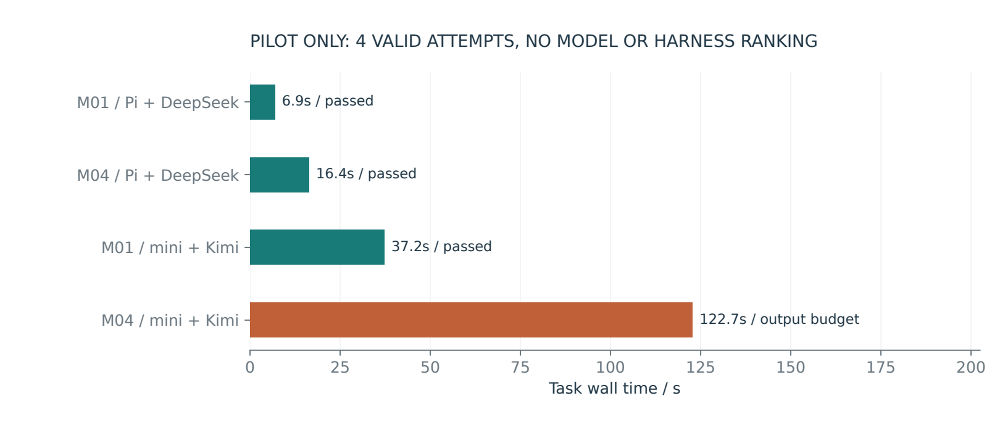

<article class="cae-article">

<a href="/articles/mechanics-agent-benchmark/benchmark_zh.pdf">中文 PDF</a> · <a href="/articles/mechanics-agent-benchmark/benchmark_en.pdf">English PDF</a> · <a href="/articles/mechanics-agent-benchmark/mechanics-benchmark-v0.1-source-evidence.zip">Code, tasks and complete traces</a>

<blockquote>
<strong>Development pilot, not a leaderboard.</strong> Eight task families are specified and two 1D mechanics fixtures execute. Four valid attempts yielded three passes and one output-budget exhaustion; two invalid setup attempts remain in the evidence. No evaluated 3D industrial solve is claimed.
</blockquote>
<h2>From engineering experience to verifiable tasks</h2>

Turn modeling, substructure partitioning, tolerance application, contact analysis and boundary search into executable tasks. Agents must operate tools and produce artifacts that survive independent numerical validation. Model, harness and tool configuration are recorded separately.

<figure><figcaption>Separate model, harness, tools and scoring; this pilot does not evaluate vendor solver tasks.</figcaption></figure>
<h2>Eight task families</h2>

<table><thead><tr><th>ID</th><th>Task</th><th>State</th></tr></thead><tbody>
<tr><td>M01</td><td>Load, units and equilibrium</td><td>Fixture executable</td></tr>
<tr><td>M02</td><td>Mechanics-driven mesh allocation</td><td>Specified only</td></tr>
<tr><td>M03</td><td>Nonlinear preload and contact</td><td>Specified only</td></tr>
<tr><td>M04</td><td>Autonomous substructure partition</td><td>Fixture executable</td></tr>
<tr><td>M05</td><td>Bounded manufacturing variables</td><td>Specified only</td></tr>
<tr><td>M06</td><td>Library reuse and interface integrity</td><td>Specified only</td></tr>
<tr><td>M07</td><td>Pose failure-boundary search</td><td>Specified only</td></tr>
<tr><td>M08</td><td>Failure recovery and trusted ranking</td><td>Specified only</td></tr>
</tbody></table>

<h2>Importance must be justified mechanically</h2>

The executable partition fixture preserves active bilinear regions, condenses a contiguous linear segment and retains interface DOFs. Low stress alone does not establish irrelevance. Validate the target response over the load envelope; the figure demonstrates only this public 1D fixture.

<figure><figcaption>Partition and load-envelope checks, not connector experimental curves.</figcaption></figure>
<h2>Measured pilot and uncertainty</h2>

<table><thead><tr><th>Task</th><th>Configuration</th><th>s</th><th>Outcome</th></tr></thead><tbody>
<tr><td>M01</td><td>Pi + DeepSeek</td><td>6.88</td><td>passed</td></tr>
<tr><td>M04</td><td>Pi + DeepSeek</td><td>16.36</td><td>passed</td></tr>
<tr><td>M01</td><td>mini + Kimi</td><td>37.25</td><td>passed</td></tr>
<tr><td>M04</td><td>mini + Kimi</td><td>122.72</td><td>output_budget_exhausted</td></tr>
</tbody></table>

<figure><figcaption>Four valid pilot attempts, not evidence for a model or harness ranking.</figcaption></figure>

The configured kimi-k2.5 route was unavailable; the pilot explicitly selected catalog-listed kimi-k2.6. DeepSeek used request ID deepseek-v4-flash through Pi SDK 0.73.1. Output was capped at 4096 tokens per request. Model and harness change together, preventing causal attribution. Actual API invoices are unknown; SDK zero-cost fields do not imply free usage.

<h2>Evidence and next steps</h2>

The bundle retains all attempts, queries, observable requests/outputs, tool interactions, numerical artifacts, independent checks, bilingual appendices and hashes. It excludes keys, the CCS database and private industrial models. A separate read-only probe verified 54 tools across three CAE MCP services; setup work is not agent evaluation. Next come public 3D fixtures and validators for the remaining six families, followed by a preregistered repeated campaign.

<a href="/articles/mechanics-agent-benchmark/pilot_summary.csv">Pilot CSV</a> · <a href="/articles/mechanics-agent-benchmark/pilot_summary.json">Pilot JSON</a> · <a href="/articles/mechanics-agent-benchmark/mechanics-benchmark-v0.1-source-evidence.zip">Source / evidence ZIP</a>

</article>