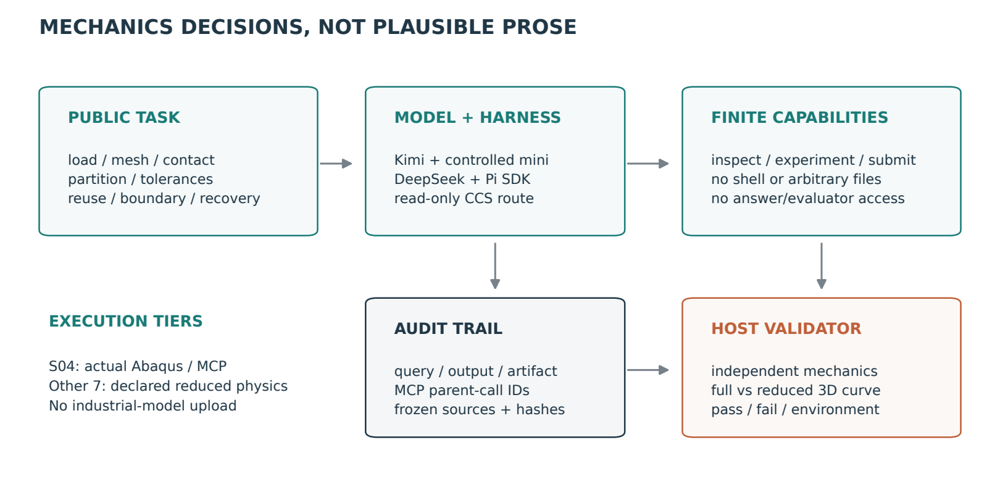
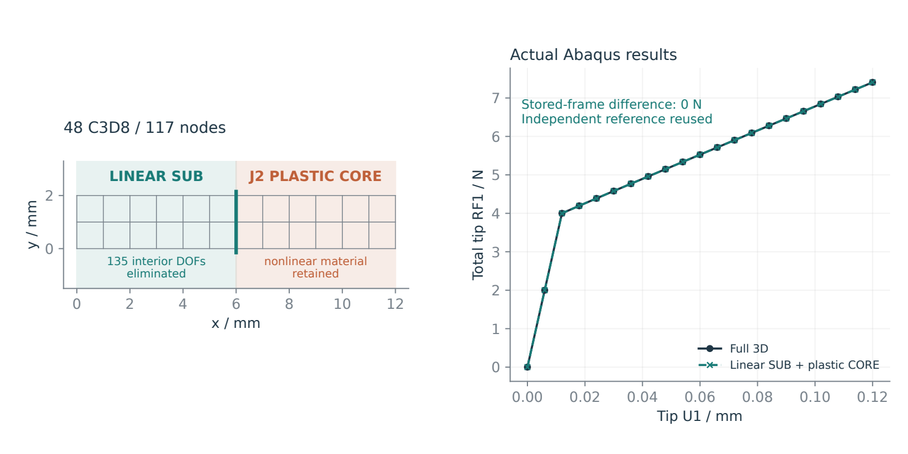
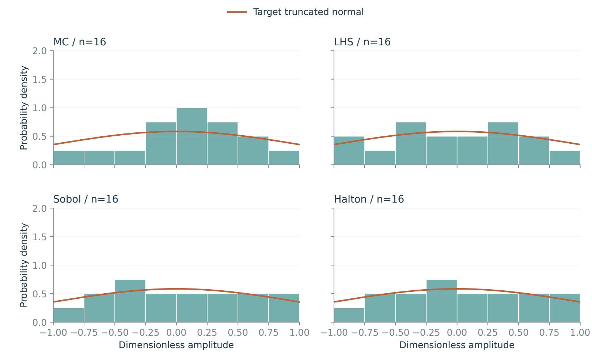
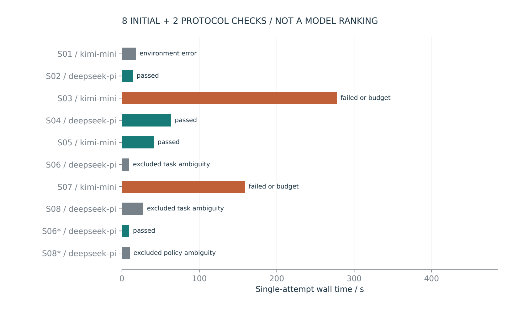

<article class="cae-article">

<a href="/articles/mechanics-benchmark-v02/benchmark_v02_zh.pdf">中文 PDF</a> · <a href="/articles/mechanics-benchmark-v02/benchmark_v02_en.pdf">English PDF</a> · <a href="/articles/mechanics-benchmark-v02/mechanics-benchmark-v0.2-source-evidence.zip">Source, tasks and complete evidence</a>

<blockquote>
<strong>Eight executable exercises, not eight vendor-solver tasks.</strong> S04 executes actual Abaqus/MCP; seven tasks use explicitly reduced physics or engineering evidence. This single-attempt development pilot is not a model or harness ranking.
</blockquote>
<h2>From modeling practice to autonomous decisions</h2>

Tasks cover units/equilibrium, mesh allocation, independent prelift, substructure regions, bounded tolerances, library reuse, coupled pose boundaries and recovery. Every exercise requires controlled execution and artifacts; prose alone cannot pass. Agents have no reference-answer, arbitrary-file, shell or network access.

<figure><figcaption>Separate model, harness, controlled tools, evidence and independent checks.</figcaption></figure>
<h2>Eight exercises and execution tiers</h2>

<table><thead><tr><th>ID</th><th>Task</th><th>Tier</th></tr></thead><tbody>
<tr><td>S01</td><td>Units, series compliance and equilibrium</td><td>Reduced physics/evidence</td></tr>
<tr><td>S02</td><td>Goal-oriented mesh allocation</td><td>Reduced physics/evidence</td></tr>
<tr><td>S03</td><td>Independent prelift and unilateral contact</td><td>Reduced physics/evidence</td></tr>
<tr><td>S04</td><td>Autonomous 3D substructure partition</td><td>Actual Abaqus/MCP</td></tr>
<tr><td>S05</td><td>Bounded sampling and physical tolerance mapping</td><td>Reduced physics/evidence</td></tr>
<tr><td>S06</td><td>Reuse, geometry compatibility and Tie coverage</td><td>Reduced physics/evidence</td></tr>
<tr><td>S07</td><td>Coupled offset-angle first-loss boundary</td><td>Reduced physics/evidence</td></tr>
<tr><td>S08</td><td>Failure recovery and trustworthy ranking</td><td>Reduced physics/evidence</td></tr>
</tbody></table>

<h2>An agent selects a 3D substructure region</h2>

DeepSeek/Pi selected the 6 mm cut, retaining three translations at18 root/interface nodes and eliminating135 interior translations. Actual tools generated a SIM library, assembled/solved the reduced3D model and extracted21ODB frames. Full/reduced reactions agree at stored precision, with endpoint7.40683 N. Solver receipts and independent checks are bundled. This validates the public fixture, not an industrial speedup.

<figure><figcaption>Public3D mesh/material partition and actual full/reduced Abaqus curves.</figcaption></figure>
<h2>Tolerance sampling and physical mapping</h2>

The 72 variables comprise 42Z shapes,6 independent prelifts and24 CORE-terminal X/Y offsets. Four samplers use an inverse standard-normal distribution conditioned on[-1,1], not clipping. Physical scales are 0.15 mm,nominal0.3348 mm plus0.15 mm amplitude,and0.1 mm. The 16-sample illustration explains rules, not comparative efficiency.

<figure><figcaption>Author-generated illustration from frozen inputs; not an agent score.</figcaption></figure>
<h2>Pilot outcomes and failure evidence</h2>

10 attempts yielded 4 passes, 1 environment errors and 6 valid attempts.Three raw scores are excluded for underspecified typing,ranking or recovery policy. S08 recovery proposals conflicted with a minimal-recovery policy not fully stated in the prompt; this cannot be blamed on the model. Delivered v0.2.2 clarifies it without further inference. Budget failures were not retried; different tasks,models and harnesses prevent ranking.

<figure><figcaption>Single-attempt elapsed times and states, retaining budget failures and service limits.</figcaption></figure>

<table><thead><tr><th>Task</th><th>Configuration</th><th>Outcome</th><th>s</th></tr></thead><tbody>
<tr><td>S01 / initial</td><td>kimi-mini</td><td>environment_error</td><td>17.8</td></tr>
<tr><td>S02 / initial</td><td>deepseek-pi</td><td>passed</td><td>14.1</td></tr>
<tr><td>S03 / initial</td><td>kimi-mini</td><td>failed_or_budget</td><td>277.5</td></tr>
<tr><td>S04 / initial</td><td>deepseek-pi</td><td>passed</td><td>63.3</td></tr>
<tr><td>S05 / initial</td><td>kimi-mini</td><td>passed</td><td>41.1</td></tr>
<tr><td>S06 / initial</td><td>deepseek-pi</td><td>excluded_task_ambiguity</td><td>9.3</td></tr>
<tr><td>S07 / initial</td><td>kimi-mini</td><td>failed_or_budget</td><td>158.9</td></tr>
<tr><td>S08 / initial</td><td>deepseek-pi</td><td>excluded_task_ambiguity</td><td>27.4</td></tr>
<tr><td>S06 / amended</td><td>deepseek-pi</td><td>passed</td><td>9.4</td></tr>
<tr><td>S08 / amended</td><td>deepseek-pi</td><td>excluded_policy_ambiguity</td><td>10.0</td></tr>
</tbody></table>

<h2>Reproduction, cost and extension</h2>

The bundle provides bilingual query/output appendices,redacted JSONL,independent checks,hashes,original public decks and Tavotto sources/receipts. Main reports are LaTeX PDFs. CCS routes are read-only,no credits were purchased,and billing is unknown; Pi zero-cost fields do not imply free usage. Production APP,industrial models and old batches were not changed.

Only mini and Pi are validated. A new client must implement the same tools/logging before claiming compatibility. Formal comparisons need crossed configurations on identical tasks,repeats and preregistered spending. Native3D frictional contact,HyperMesh adaptation and unrestricted-agent isolation remain extensions.

<a href="/articles/mechanics-benchmark-v02/summary.csv">CSV</a> · <a href="/articles/mechanics-benchmark-v02/summary.json">JSON</a> · <a href="/articles/mechanics-benchmark-v02/preregistration.json">Frozen registry</a>

</article>