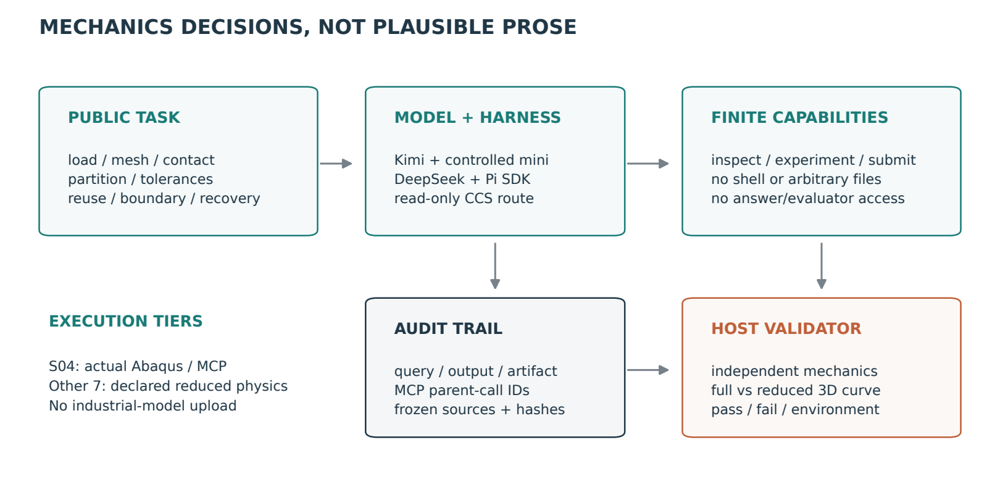
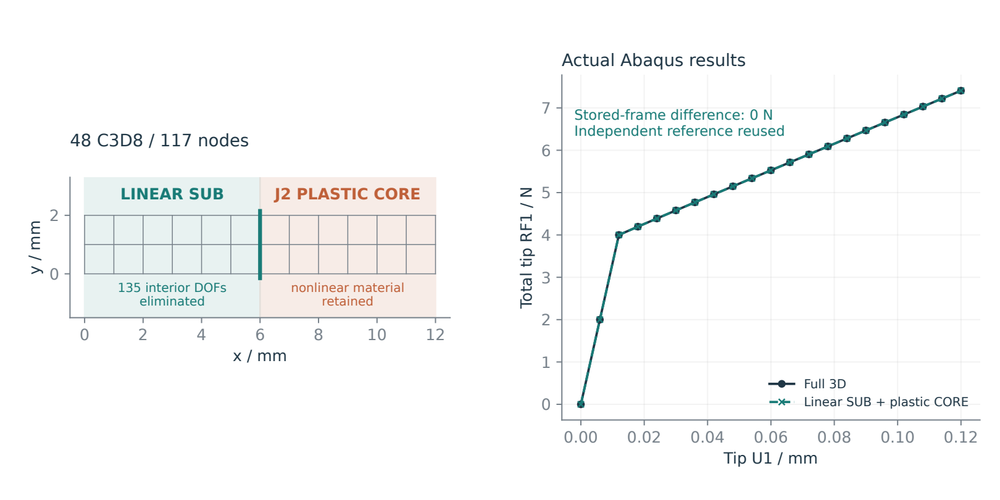
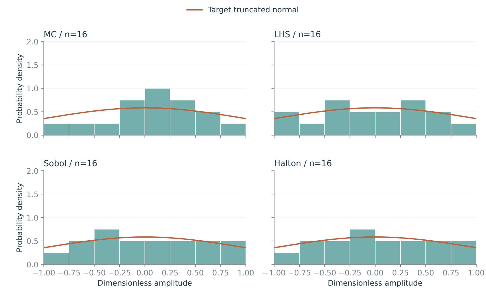
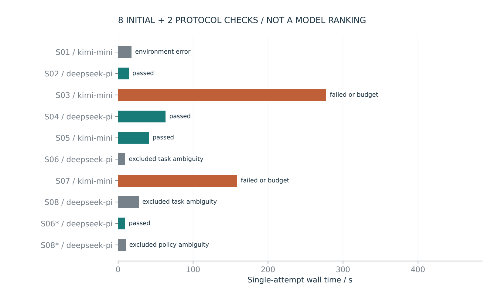

<article class="cae-article">

<a href="/articles/mechanics-benchmark-v02/benchmark_v02_zh.pdf">中文 PDF</a> · <a href="/articles/mechanics-benchmark-v02/benchmark_v02_en.pdf">English PDF</a> · <a href="/articles/mechanics-benchmark-v02/mechanics-benchmark-v0.2-source-evidence.zip">源码、题库与完整证据</a>

<blockquote>
<strong>八题可执行，不等于八道商业求解器任务。</strong> S04运行真实Abaqus/MCP，其余七题为明确标注的简化力学或工程证据题。本次为单次开发试跑，不是模型或框架排行榜。
</blockquote>
<h2>从建模经验到自主决策题</h2>

基准覆盖量纲和平衡、网格分配、独立预抬、子结构区域选择、有界公差、库复用、偏位偏角边界，以及故障恢复。每道题都要求受控工具执行与真实产物；文字解释本身不能获得通过。模型看不到参考答案、任意文件、shell或网络工具。

<figure><figcaption>模型、框架、受控工具、证据与独立判分分层。</figcaption></figure>
<h2>八道题与执行层级</h2>

<table><thead><tr><th>ID</th><th>任务</th><th>执行层级</th></tr></thead><tbody>
<tr><td>S01</td><td>单位、串联柔度与平衡</td><td>简化力学/证据</td></tr>
<tr><td>S02</td><td>面向目标响应的网格分配</td><td>简化力学/证据</td></tr>
<tr><td>S03</td><td>独立预抬与单边接触</td><td>简化力学/证据</td></tr>
<tr><td>S04</td><td>三维子结构自主分区</td><td>实际Abaqus/MCP</td></tr>
<tr><td>S05</td><td>有界抽样及物理公差映射</td><td>简化力学/证据</td></tr>
<tr><td>S06</td><td>复用、几何兼容与绑定覆盖</td><td>简化力学/证据</td></tr>
<tr><td>S07</td><td>偏位偏角耦合首失效边界</td><td>简化力学/证据</td></tr>
<tr><td>S08</td><td>故障恢复与可信排序</td><td>简化力学/证据</td></tr>
</tbody></table>

<h2>模型自主决定三维子结构区域</h2>

DeepSeek/Pi选择6mm截面，保留根部和接口共18个节点的三向平移，消去135个内部平移自由度。真实工具随后生成SIM库、装配并求解三维降阶模型，提取21个ODB帧；完整与降阶反力曲线在存储精度下一致，终点反力为7.40683N。实际求解回执与独立核验包含在下载包中。该结果证明这个公开算例的执行与等价性，不证明工业加速比。

<figure><figcaption>公开三维网格材料分区，以及真实Abaqus完整/降阶曲线。</figcaption></figure>
<h2>公差抽样与物理映射</h2>

72维变量由42个Z向shape、6个小板独立预抬和24个公端子X/Y局部平移组成。四种抽样均使用[-1,1]截断标准正态逆分布映射，而不是裁剪。尺寸比例分别为0.15mm、名义0.3348mm加0.15mm幅值、以及0.1mm。下图仅用16个样本解释规则，不用直方图证明方法优劣。

<figure><figcaption>作者根据冻结输入生成的抽样示意，不计为agent成绩。</figcaption></figure>
<h2>试跑结果与失败证据</h2>

10次尝试中4次通过，1次服务或环境错误，6次有效尝试。共三次原始分数因输出类型、排序方向或恢复策略没有充分说明而排除，详情见审查记录。S08复核的恢复建议不符合最小恢复策略，但该策略未完整写入原题，不能归咎模型。交付v0.2.2已澄清，未追加推理。预算失败不重试；不同任务、模型和框架的成绩不能用于排名。

<figure><figcaption>单次任务耗时与状态，包括未通过和服务限流，不隐去失败。</figcaption></figure>

<table><thead><tr><th>Task</th><th>Configuration</th><th>Outcome</th><th>s</th></tr></thead><tbody>
<tr><td>S01 / initial</td><td>kimi-mini</td><td>environment_error</td><td>17.8</td></tr>
<tr><td>S02 / initial</td><td>deepseek-pi</td><td>passed</td><td>14.1</td></tr>
<tr><td>S03 / initial</td><td>kimi-mini</td><td>failed_or_budget</td><td>277.5</td></tr>
<tr><td>S04 / initial</td><td>deepseek-pi</td><td>passed</td><td>63.3</td></tr>
<tr><td>S05 / initial</td><td>kimi-mini</td><td>passed</td><td>41.1</td></tr>
<tr><td>S06 / initial</td><td>deepseek-pi</td><td>excluded_task_ambiguity</td><td>9.3</td></tr>
<tr><td>S07 / initial</td><td>kimi-mini</td><td>failed_or_budget</td><td>158.9</td></tr>
<tr><td>S08 / initial</td><td>deepseek-pi</td><td>excluded_task_ambiguity</td><td>27.4</td></tr>
<tr><td>S06 / amended</td><td>deepseek-pi</td><td>passed</td><td>9.4</td></tr>
<tr><td>S08 / amended</td><td>deepseek-pi</td><td>excluded_policy_ambiguity</td><td>10.0</td></tr>
</tbody></table>

<h2>复现、费用与扩展</h2>

下载包提供中英文逐轮query/output附录、原始脱敏JSONL、独立评分、哈希、原创建模输入及Tavotto脚本/回执。所有正文使用LaTeX编译为PDF。API由本机CCS只读接入，无购买额度；真实账单未知，Pi的零成本字段不能解释为免费。现有APP、工业模型和旧批次未改动。

当前验证mini和Pi两种框架，新增客户端必须实现相同工具与日志协议后才能标记为兼容。正式跨模型研究还需要相同任务的交叉配置、多次重复和预注册费用上限。三维摩擦接触、真实HyperMesh自适应与不受控原生agent隔离属于后续扩展。

<a href="/articles/mechanics-benchmark-v02/summary.csv">CSV</a> · <a href="/articles/mechanics-benchmark-v02/summary.json">JSON</a> · <a href="/articles/mechanics-benchmark-v02/preregistration.json">冻结规则</a>

</article>